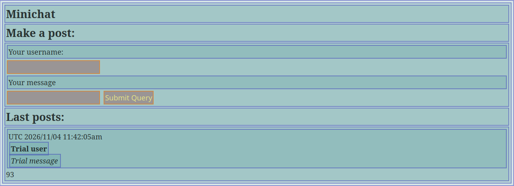

The simplest possible web chat.
It doesn't even use a database, all posts are stored in a text file.

- index.php     : the actual web page -
- postore.txt   : where the posts are stored -
- README.md     : this file -
- screenshot.png: how it looks like -
- style.css     : style and looks -

You can try a published version at:   https://heliogeorge.heliohost.us/chat.php
(warning: it uses a different graphics than this one)

Screenshot:

